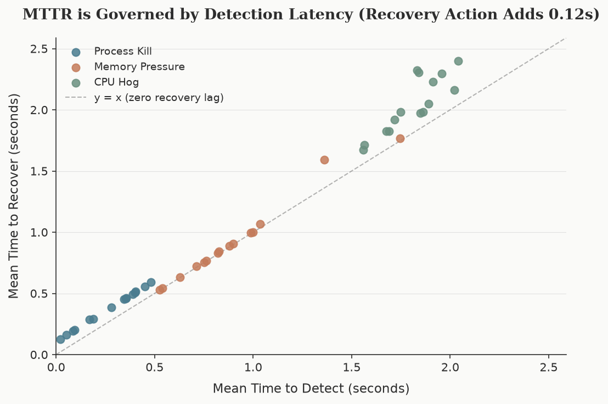

# OS Fault Injection Lab

A self-contained Linux fault injection, health monitoring, automated recovery, and empirical measurement framework. Built entirely in Python, running safely inside a Docker container using Linux kernel primitives: signals, `/proc`, `psutil`, `stress-ng`, and `cgroups v2`.

---

## 1. Motivation

Operating systems must remain resilient under severe failure modes: processes crash without warning, memory leaks trigger kernel out-of-memory kills, and compute-heavy processes saturate CPU cores. While students encounter these topics conceptually in operating systems courses, they rarely observe kernel schedulers and resource controllers handling real faults firsthand.

This project creates a safe, repeatable laboratory environment to:
1. **Inject** realistic operating system faults deliberately.
2. **Monitor** system telemetry and detect faults automatically.
3. **Recover** service availability through automated self-healing mechanisms.
4. **Measure** detection latency (MTTD) and recovery latency (MTTR) across multiple randomized trials.
5. **Visualize** the findings through publication-quality charts.

Everything executes inside a single Docker container. Fault injection is restricted to container resources, ensuring the host system is never modified or endangered.

---

## 2. Implemented Faults & OS Concepts

The framework implements three distinct fault injection scenarios, each highlighting specific Linux kernel subsystems:

| Fault Type | Injection Mechanism | Detection Mechanism | Recovery Action | Key OS Concepts |
|---|---|---|---|---|
| **Process Kill** | `os.kill(pid, signal.SIGKILL)` | Polling loop checking PID status, handling zombie child processes | Process supervisor re-launches target with cooldown and retry limits | Unix signals (`SIGKILL` vs. `SIGTERM`), PIDs, zombie processes (`STATUS_ZOMBIE`), process table reaping |
| **Memory Pressure** | Background worker allocates memory inside isolated cgroup v2 with hard cap (`memory.max = 64MB`, `swap = 0`) | Continuous polling of `memory.current / memory.max` and monotonic `oom_kill` counter in `memory.events` | OOM killer terminates hog; supervisor reaps and removes cgroup directory | Cgroups v2 hierarchy, memory controllers, OOM killer victim selection, swap suppression |
| **CPU Hog** | `stress-ng --cpu N` saturating all available CPU cores | Sustained CPU utilization above 90% for 3 consecutive polling intervals (debouncing) | Recursive termination of `stress-ng` process tree and zombie reaping | Completely Fair Scheduler (CFS), virtual runtime (`vruntime`), load average vs. CPU percentage |

---

## 3. Architecture & Data Flow

The architecture follows a strict separation of concerns, communicating exclusively through a shared append-only JSON Lines event log.

```
       +---------------------------------------------+
       |             experiment.runner               |
       |  (Trial Orchestration & Jitter Scheduling)  |
       +----------------------+----------------------+
                              |
     +------------------------+------------------------+
     |                        |                        |
     v                        v                        v
+------------+         +-------------+          +--------------+
|  injector  |         |   monitor   |          |   recovery   |
| (SIGKILL / |         |  (Polling   |          | (Supervisor  |
| Memory /   |         |  detector / |          |  & Resource  |
| stress-ng) |         |  cgroups)   |          |  Reclaiming) |
+-----+------+         +------+------+          +-------+------+
      |                       |                         |
      |   INJECTED            |   DETECTED              |   RECOVERED
      +---------------------->+------------------------>+
                              |
                              v
                  +-----------------------+
                  | results/event_log.jsonl|
                  +-----------+-----------+
                              |
                              v
                  +-----------------------+
                  |  experiment.metrics   |
                  |     (MTTD & MTTR)     |
                  +-----------+-----------+
                              |
                              v
                  +-----------------------+
                  |  experiment.results   |
                  | (CSV & Matplotlib)    |
                  +-----------------------+
```

### The Shared Event Log

Components write to `results/event_log.jsonl` with atomic appends and immediate flushes. Each entry contains:
- `timestamp`: ISO 8601 high-resolution timestamp.
- `trial_id`: Trial identifier (e.g., `process_kill_001`).
- `fault_type`: One of `process_kill`, `memory_pressure`, or `cpu_hog`.
- `event`: Lifecycle event (`STARTED`, `INJECTED`, `DETECTED`, `RECOVERED`, `FAILED`).
- `details`: Human-readable diagnostics (PIDs, breach percentages, counters).

---

## 4. Project Structure

```
OS Fault Injection Lab/
├── config.py                 # Central configuration tunables (no magic numbers)
├── event_log.py              # Shared JSONL event log reader and writer
├── Dockerfile                # Debian slim container with stress-ng & procps
├── docker-compose.yml        # Privileged Docker configuration mounting results/
├── requirements.txt          # Python dependencies: psutil, matplotlib
├── docs/                     # Engineering specifications & viva study notes
│   ├── images/               # Publication charts
│   │   ├── mttd_by_fault.png
│   │   ├── mttr_by_fault.png
│   │   ├── success_rate.png
│   │   └── mttd_vs_mttr.png
│   ├── prd.md                # Product requirements document
│   ├── architecture.md       # Architectural blueprint & module contracts
│   ├── rules.md              # Coding standards and operating protocol
│   ├── design.md             # Visual design system (palette, charts, tables)
│   ├── tasks.md              # 10-phase task breakdown and progress tracker
│   ├── memory.md             # Project decisions log and state history
│   ├── process_kill_notes.md # Learning notes: signals, zombies, supervision
│   ├── oom_killer_notes.md   # Learning notes: cgroups v2, memory.events, OOM
│   └── cpu_scheduling_notes.md # Learning notes: CFS, load avg vs. CPU percent
├── target/                   # Target workload application
│   ├── __init__.py
│   └── heartbeat_app.py      # Heartbeat process simulating an active service
├── injector/                 # Fault injection engines
│   ├── __init__.py
│   ├── process_kill.py       # SIGKILL process crash injector
│   ├── memory_pressure.py    # Cgroup memory limit & hog allocator
│   └── cpu_hog.py            # stress-ng CPU saturation engine
├── monitor/                  # Telemetry and anomaly detection
│   ├── __init__.py
│   ├── detector.py           # Threshold evaluations & zombie detection
│   └── monitor.py            # Polling loop measuring CPU, memory, and liveness
├── recovery/                 # Self-healing engines
│   ├── __init__.py
│   ├── supervisor.py         # Process restart supervisor with retry & cooldown
│   └── resource_recovery.py  # Hog process termination and cgroup reclamation
├── experiment/               # Trial orchestration, metrics, and visualization
│   ├── __init__.py
│   ├── runner.py             # Orchestrates trials with random pre-injection jitter
│   ├── metrics.py            # Computes MTTD, MTTR, and statistical aggregates
│   └── results.py            # Writes CSV data and generates publication charts
├── scripts/                  # Utility scripts
│   ├── safety_check.py       # Pre-flight container isolation & safety verification
│   └── demo.py               # Interactive single-command demonstration
├── tests/                    # Unit test suite (Python standard unittest)
│   ├── __init__.py
│   ├── test_event_log.py     # Event log atomic append, read, filter, clear
│   ├── test_metrics.py       # MTTD/MTTR calculation and aggregates logic
│   ├── test_detector.py      # CPU debouncing and cgroup threshold logic
│   └── test_supervisor.py    # Supervisor retry, cooldown, and liveness checks
└── results/                  # Generated experiment outputs (gitignored)
    ├── .gitkeep
    ├── event_log.jsonl       # Raw trial events
    ├── results.csv           # Tabular per-trial metrics
    ├── mttd_by_fault.png     # Publication chart: MTTD by fault type
    ├── mttr_by_fault.png     # Publication chart: MTTR by fault type
    ├── success_rate.png      # Publication chart: Recovery success rate
    └── mttd_vs_mttr.png      # Publication chart: MTTD vs. MTTR correlation
```

---

## 5. Prerequisites & Safety

### Requirements
- Docker and Docker Compose installed on the host (Linux, macOS, or Windows with WSL2).
- No Python installation required on the host (everything runs in the container).

### Safety Guarantee
Fault injection commands (`kill -9`, memory limits, CPU hogs) **must never run directly on the host operating system**. 

The framework enforces this safety barrier via `scripts/safety_check.py`:
- Checks for container isolation markers (`/.dockerenv`).
- Verifies cgroups v2 availability (`/sys/fs/cgroup/cgroup.controllers`).
- Verifies `stress-ng` and `psutil` availability.
- Immediately halts with exit code 1 if invoked outside Docker.

---

## 6. How to Run

### 1. Pre-flight Safety Verification
```bash
# Inside container (passes):
docker compose run --rm lab python scripts/safety_check.py

# On host (fails by design, protecting the host system):
python scripts/safety_check.py
```

### 2. Run the Interactive Demonstration
Executes a quick trial of each fault type, updates CSV results, and generates publication charts in seconds:
```bash
docker compose run --rm lab python scripts/demo.py
```

### 3. Run the Full 45-Trial Experiment Suite
Runs 15 trials per fault type (45 total trials) with randomized pre-injection jitter:
```bash
docker compose run --rm lab python -m experiment.runner --fault all --trials 15
```

### 4. Run an Individual Fault Type
```bash
# Process kill (15 trials):
docker compose run --rm lab python -m experiment.runner --fault process_kill --trials 15

# Memory pressure (15 trials):
docker compose run --rm lab python -m experiment.runner --fault memory_pressure --trials 15

# CPU hog (15 trials):
docker compose run --rm lab python -m experiment.runner --fault cpu_hog --trials 15
```

### 5. Regenerate Charts Standalone
Regenerate all charts from `results/results.csv` without re-running experiments:
```bash
docker compose run --rm lab python -m experiment.results
```

### 6. Run the Unit Test Suite
Execute all 22 unit tests using standard library `unittest`:
```bash
docker compose run --rm lab python -m unittest discover tests -v
```

---

## 7. Sample Experimental Results

Below are representative empirical results obtained from a 45-trial suite (15 trials per fault type):

```
Results: process_kill (15 trials)
---
                    Mean    Median      Min      Max
  MTTD (sec)        0.272     0.345    0.021    0.481
  MTTR (sec)        0.379     0.451    0.126    0.590
  Success rate     100.0%

Results: memory_pressure (15 trials)
---
                    Mean    Median      Min      Max
  MTTD (sec)        0.898     0.826    0.526    1.745
  MTTR (sec)        0.923     0.844    0.530    1.769
  Success rate     100.0%

Results: cpu_hog (15 trials)
---
                    Mean    Median      Min      Max
  MTTD (sec)        1.811     1.839    1.559    2.042
  MTTR (sec)        2.044     1.982    1.674    2.398
  Success rate     100.0%
```

### Publication Charts

| Detection Latency (MTTD) | Recovery Latency (MTTR) |
|:---:|:---:|
|  |  |

| Automated Recovery Success Rate | MTTD vs. MTTR Correlation |
|:---:|:---:|
|  |  |

### Scientific Explanation of Latency Differences

1. **Process Kill (Mean MTTD: 0.272s)**
   - `os.kill(pid, SIGKILL)` terminates execution in less than 1 millisecond.
   - The monitor polls process liveness at interval $T_{\text{poll}} = 0.5\text{s}$.
   - Uniform pre-injection jitter $[0, 0.5\text{s}]$ simulates arbitrary fault arrival, causing MTTD to distribute continuously across $[0, 0.5\text{s}]$ with an observed mean of $0.272\text{s}$, closely matching the theoretical expected mean of $T_{\text{poll}} / 2 = 0.250\text{s}$.

2. **Memory Pressure (Mean MTTD: 0.898s)**
   - Memory cannot be exhausted instantaneously. The memory hog allocates 8MB bytearrays every 50ms, requiring approximately $0.40\text{s}$ to allocate sufficient resident memory to breach the 64MB cgroup limit.
   - Observed MTTD represents the physical memory allocation ramp-up latency ($\sim 0.40\text{s}$) plus the monitor polling phase delay ($\sim 0.25\text{s}-0.50\text{s}$).

3. **CPU Hog (Mean MTTD: 1.811s)**
   - While `stress-ng` saturates CPU cores immediately, instantaneous CPU spikes are common in real systems.
   - To prevent false alarms, the detector applies a **3-poll debounce filter** (`CONSECUTIVE_POLLS_THRESHOLD = 3`).
   - 3 consecutive polls at 0.5s intervals establish a hard minimum baseline of $1.50\text{s}$. Adding the initial polling phase offset yields an observed mean MTTD of $1.811\text{s}$.

4. **Self-Healing MTTR Dynamics**
   - In all fault types, recovery action overhead (restarting target process or unlinking cgroups / terminating stress-ng) requires a constant $\sim 0.08\text{s}-0.23\text{s}$.
   - Because recovery begins immediately upon detection, MTTR is directly governed by MTTD: $\text{MTTR} \approx \text{MTTD} + \Delta t_{\text{recovery}}$.

---

## 8. Viva & Examination Q&A Reference

1. **Q: Why can't we use `psutil.virtual_memory()` to detect memory pressure in containers?**
   - *A:* `psutil.virtual_memory()` parses `/proc/meminfo`, which exposes the host machine's total physical RAM (e.g., 16GB or 32GB). It is unaware of container or cgroup boundaries. If a container is restricted to 64MB, `psutil` will still report gigabytes of free memory. Real container-aware monitoring must read `/sys/fs/cgroup/memory.current` and `/sys/fs/cgroup/memory.max`.

2. **Q: Why does `psutil.pid_exists(pid)` return `True` for crashed processes?**
   - *A:* When a process terminates, its kernel task structure remains in the process table in state `STATUS_ZOMBIE` until the parent reaps it via `waitpid()`. Because the PID exists in `/proc`, `psutil.pid_exists(pid)` returns `True`. Fault detectors must inspect process status (`proc.status() == psutil.STATUS_ZOMBIE`) and treat zombies as dead.

3. **Q: Why is load average unsuitable for real-time fault detection compared to CPU percentage?**
   - *A:* Load average is an exponentially damped 1-, 5-, and 15-minute moving average of runnable tasks. It takes minutes to rise under sudden load and minutes to decay after recovery. Detecting active CPU starvation requires instantaneous window sampling (`psutil.cpu_percent(interval=None)`).

4. **Q: How does the heartbeat target survive 100% CPU saturation without dropping ticks?**
   - *A:* The Linux Completely Fair Scheduler (CFS) allocates CPU time based on virtual runtime (`vruntime`). The CPU hog runs tight computation loops, causing its `vruntime` to increase rapidly. The heartbeat sleeps for 1.0s, accumulating zero `vruntime`. When it wakes, CFS immediately preempts the hog and schedules the heartbeat.

---

## 9. License

Educational project developed for Operating Systems studies. Available under the MIT License.
