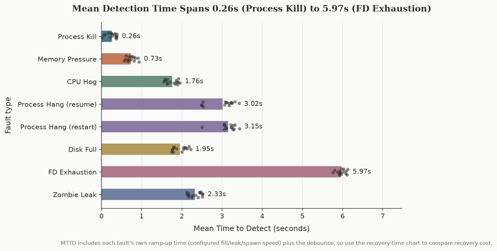
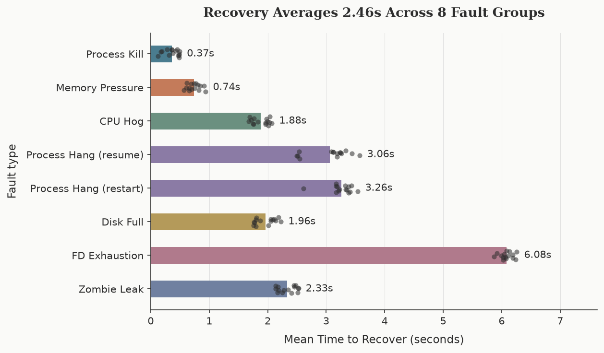
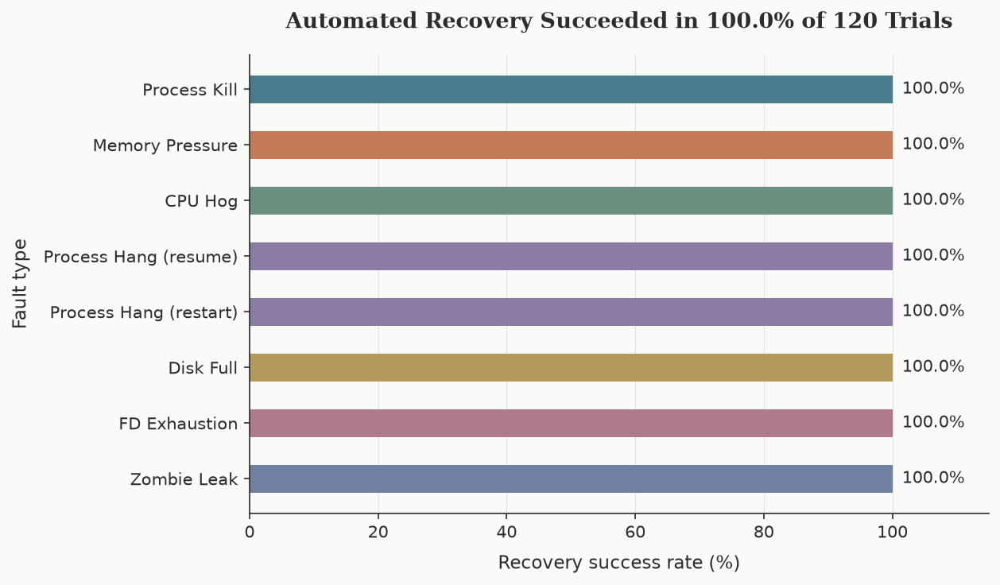
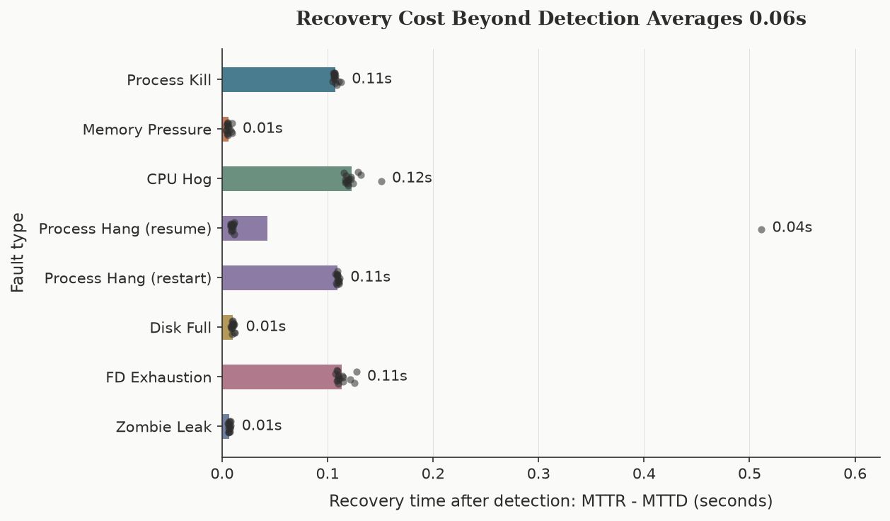

# OS Fault Injection Lab

A self-contained Linux fault injection, health monitoring, automated recovery, and empirical measurement framework. Built entirely in Python, running safely inside a Docker container using Linux kernel primitives: signals, `/proc`, cgroups v2, tmpfs, `psutil`, and `stress-ng`.

---

## 1. What It Does

Operating systems must tolerate faults: processes crash, hang, exhaust memory, file descriptors, disk space, and CPU. Students learn these topics conceptually but rarely observe the kernel handling them firsthand. This project injects realistic OS faults deliberately, detects them automatically, recovers from them, and measures **MTTD** (mean time to detect) and **MTTR** (mean time to recover) across randomized trials — inside a disposable container, so the host is never at risk.

Every fault follows the same measured loop: `INJECTED → DETECTED → RECOVERED`, written to a shared JSONL event log that is the only communication channel between components.

---

## 2. The Seven Faults

| Fault | How it is injected | How it is detected | How it is recovered | OS concept learned |
|---|---|---|---|---|
| **Process Kill** | `os.kill(pid, SIGKILL)` on the target | Target PID gone or zombie (`psutil`) | Supervisor restart with retries + cooldown | Signals, PID lifecycle, supervision |
| **Memory Pressure** | Memory hog inside a cgroup v2 with hard `memory.max` (swap off) | cgroup `memory.current/memory.max` ratio + `oom_kill` counter in `memory.events` | Kill/confirm hog dead, remove cgroup, restart target if affected | Cgroups v2, OOM killer, swap |
| **CPU Hog** | `stress-ng --cpu N` saturating all cores | `psutil.cpu_percent()` above 90% for 3 consecutive polls | Kill the stress-ng tree, verify CPU drops | CFS scheduling, load average, debouncing |
| **Process Hang** | `SIGSTOP` freezes the target (still alive) | **Heartbeat staleness** — no fresh timestamp within 3s; deliberately not a liveness check | Resume (`SIGCONT`) or restart; `RECOVERED` only after a fresh heartbeat | Process states, alive vs healthy, `SIGSTOP`/`SIGCONT` |
| **Disk Full** | Size-capped tmpfs (16MB) mounted and filled to `ENOSPC` | `psutil.disk_usage().percent` above 90% for 3 polls | Kill writer, delete files, verify usage drops, unmount | Mounts, tmpfs, `ENOSPC`, `df` vs `du` |
| **FD Exhaustion** | Leaker lowers **its own** `RLIMIT_NOFILE` to 256, opens `/dev/null` until `EMFILE` | `num_fds()` / own soft limit above 90% for 3 polls | Kill and reap leaker, start fresh instance, verify low fd count | fd table, rlimits, `EMFILE`, `/proc/<pid>/fd` |
| **Zombie Leak** | Parent `os.fork()`s short-lived children it never reaps (capped at 200) | Leaker's direct children in `STATUS_ZOMBIE` above 20 for 3 polls | Kill parent, reap orphans adopted by PID 1, verify zero zombies | Zombies vs orphans, reparenting, why init reaps |

---

## 3. Architecture & Data Flow

```
     +---------------------------------------------+
     |              experiment.runner               |
     |  (Trial orchestration, random pre-injection  |
     |   jitter, per-trial cleanup + verification)  |
     +----------------------+----------------------+
                            |
     +----------------------+----------------------+
     |                      |                      |
     v                      v                      v
+------------+      +-------------+        +--------------+
|  injector  |      |   monitor   |        |   recovery   |
| (signals,  |      | (polling +  |        | (supervisor  |
| cgroups,   |      |  detector   |        |  & resource  |
| tmpfs,     |      |  branches)  |        |  reclaiming) |
| forks)     |      +------+------+        +-------+------+
+-----+------+             |                       |
      |   INJECTED         | DETECTED              | RECOVERED
      +------------------->+---------------------->+
                           v
                +------------------------+
                | results/event_log.jsonl|
                +-----------+------------+
                            v
                +------------------------+
                | experiment.metrics     |  MTTD / MTTR per trial
                +-----------+------------+
                            v
                +------------------------+
                | experiment.results     |  results.csv + 4 charts
                +------------------------+
```

The monitor always starts **before** injection, and injection is delayed by a uniform random jitter, so MTTD is never phase-locked to the polling cycle.

---

## 4. Project Structure

```
OS Fault Injection Lab/
├── config.py                 # All tunables (thresholds, paths, caps — no magic numbers)
├── event_log.py              # Shared JSONL event log
├── injector/                 # One module per fault (7)
├── monitor/                  # monitor.py polling loop + detector.py threshold logic
├── recovery/                 # supervisor.py (process restart/resume) + resource_recovery.py
├── experiment/               # runner.py (orchestration), metrics.py (MTTD/MTTR), results.py (CSV + charts)
├── target/                   # heartbeat_app.py — the victim service (writes heartbeat timestamps)
├── scripts/                  # safety_check.py (pre-flight), demo.py (one-command demo)
├── tests/                    # 40 unit tests (stdlib unittest)
├── docs/                     # PRD, architecture, design, notes per fault, images/
└── results/                  # Generated outputs (gitignored): event_log.jsonl, results.csv, charts
```

---

## 5. Safety Guarantees

- **Container only.** `scripts/safety_check.py` verifies Docker isolation, cgroups v2, stress-ng, psutil, and tmpfs mounting — and refuses to run (exit 1) on the host.
- **tmpfs only.** The disk_full fault writes exclusively to a size-capped tmpfs verified via `/proc/mounts` (path, filesystem type, and size option); a failed mount aborts the trial. The mount is removed after every trial, including on Ctrl+C.
- **Per-process rlimit only.** The fd_exhaustion leaker lowers `RLIMIT_NOFILE` for its own process via `resource.setrlimit`; no system-wide limit is ever touched.
- **Capped zombies.** The zombie_leak parent spawns at most 200 children at a controlled rate — the container's PID table is never at risk.
- **Cleanup after every trial.** The runner kills all child processes, removes cgroups and mounts, reaps zombies, and asserts that nothing was left behind before starting the next trial.

---

## 6. Quick Start

```bash
# 1. Pre-flight safety verification (passes in Docker, fails on the host by design):
docker compose run --rm lab python scripts/safety_check.py

# 2. One-command demo: 1 trial per fault group + summary + charts:
docker compose run --rm lab python scripts/demo.py

# 3. Full suite: 7 faults x 15 trials (process_hang runs both strategies) = 120 trials:
docker compose run --rm lab python -m experiment.runner --fault all --trials 15

# 4. A single fault:
docker compose run --rm lab python -m experiment.runner --fault disk_full --trials 15

# 5. Regenerate the 4 charts from results/results.csv without re-running:
docker compose run --rm lab python -m experiment.results

# 6. Unit tests (40, stdlib unittest):
docker compose run --rm lab python -m unittest discover tests -v
```

---

## 7. Results

Computed from `results/results.csv` — 120 trials across 8 groups (7 faults; process_hang measured once per recovery strategy), 15 trials each, **100% recovery success**:

| Fault group | MTTD mean (s) | MTTR mean (s) | Recovery cost (s) | Success |
|---|---|---|---|---|
| Process Kill | 0.258 | 0.365 | 0.107 | 100% |
| Memory Pressure | 0.733 | 0.739 | 0.006 | 100% |
| CPU Hog | 1.760 | 1.883 | 0.123 | 100% |
| Process Hang (resume) | 3.016 | 3.059 | 0.043 | 100% |
| Process Hang (restart) | 3.149 | 3.259 | 0.110 | 100% |
| Disk Full | 1.953 | 1.963 | 0.010 | 100% |
| FD Exhaustion | 5.968 | 6.082 | 0.114 | 100% |
| Zombie Leak | 2.327 | 2.334 | 0.007 | 100% |

MTTD includes each fault's own ramp-up time (configured fill/leak/spawn speed) plus the detection debounce, so it is not a fair measure of recovery quality — recovery cost (MTTR − MTTD) is compared in the recovery-time chart, and it sits between 0.006s and 0.123s for every fault.

---

## 8. Charts

| Detection Latency (MTTD) | Recovery Latency (MTTR) |
|:---:|:---:|
|  |  |

| Automated Recovery Success Rate | Recovery Cost After Detection (MTTR − MTTD) |
|:---:|:---:|
|  |  |

---

## 9. Limitations

Written honestly:

- **One container, one laptop.** All faults are controlled simulations inside a single Docker container on one machine. Absolute numbers (MTTD/MTTR) vary with the host — the *relative* differences and mechanisms are the findings, not the milliseconds.
- **15 trials per group.** Enough to show a stable distribution, not a rigorous statistical study.
- **100% success ≠ real-world robustness.** The recovery mechanisms work for the faults as injected; real failures arrive with partial state, concurrent causes, and network effects that this lab does not model.
- **Resume vs restart is within noise.** The two process_hang strategies differ by ~0.07s in recovery cost — not a meaningful gap; the interesting difference (resume keeps possibly-corrupt state) is qualitative, not measured here.
- **One fault at a time.** Faults are never combined; cascading failures are out of scope.

---

## 10. Viva Q&A

**Q: Why can't we use `psutil.virtual_memory()` to detect memory pressure in containers?**
It reads the whole-VM memory and cannot see a cgroup's `memory.max`. The lab reads `memory.current`/`memory.max` from the cgroup filesystem and the `oom_kill` counter from `memory.events` instead.

**Q: A process is "alive" — is it healthy? (process hang)**
No. A `SIGSTOP`'d process keeps its PID, memory, and sockets but makes no progress. Liveness checks (`pid_exists`, status) pass, so health needs a progress signal: the target writes heartbeat timestamps to a file, and the monitor fires when none is fresh within 3 seconds.

**Q: What is the difference between `SIGSTOP` and `SIGKILL`?**
Neither can be caught or ignored. `SIGKILL` terminates the process; `SIGSTOP` freezes it in place — it still holds all resources. Consequence for cleanup: a stopped process **queues** `SIGTERM` instead of handling it, so the only reliable way to remove a frozen target is `SIGKILL` (or `SIGCONT` first).

**Q: What happens when a disk fills up? (ENOSPC)**
The kernel starts returning `ENOSPC` ("no space left on device") from writes — the process is not killed, it just keeps failing. The lab mounts a size-capped tmpfs (RAM-backed filesystem) so the fault is bounded and vanishes on unmount. Near the full mark, writes may partially succeed, which is why the recovery deletes everything in the mount.

**Q: What is EMFILE and why do leaking services fail "slowly, then suddenly"? (fd exhaustion)**
Each process has its own file-descriptor table with a per-process ceiling (`RLIMIT_NOFILE`). When every fd is taken, `open()`/`socket()` returns `EMFILE` — the process still runs but cannot accept connections or open files. Leaks accumulate gradually, so the service passes every check until it suddenly cannot work; rlimits are per-process and inherited, never system-wide.

**Q: What is a zombie, and why did killing the parent not remove the zombies?**
A zombie is a terminated process whose exit status is still unread — the parent never called `wait()`. When the parent dies, the zombies are **reparented to PID 1**; in this container PID 1 is the Python runner, which does not reap automatically (that is the job of a real init). Recovery therefore reaps them explicitly (`os.waitpid(-1, WNOHANG)`) and then *verifies* the zombie count is zero.

**Q: Why does the monitor start before the fault is injected, with random jitter?**
MTTD must include the wait for the next poll after the fault begins. A fixed delay phase-locks injection to the polling cycle (every trial would detect at ~0.45s); uniform random jitter in `[0, poll_interval]` simulates arbitrary fault arrival and yields an honest expected MTTD of ~half the poll interval.

**Q: How do you know nothing leaked after the experiments?**
After every trial — and after every full run — the runner asserts zero leftover processes, stopped processes, zombies, tmpfs mounts, and cgroups, and reports the container root filesystem's usage delta (unchanged).
